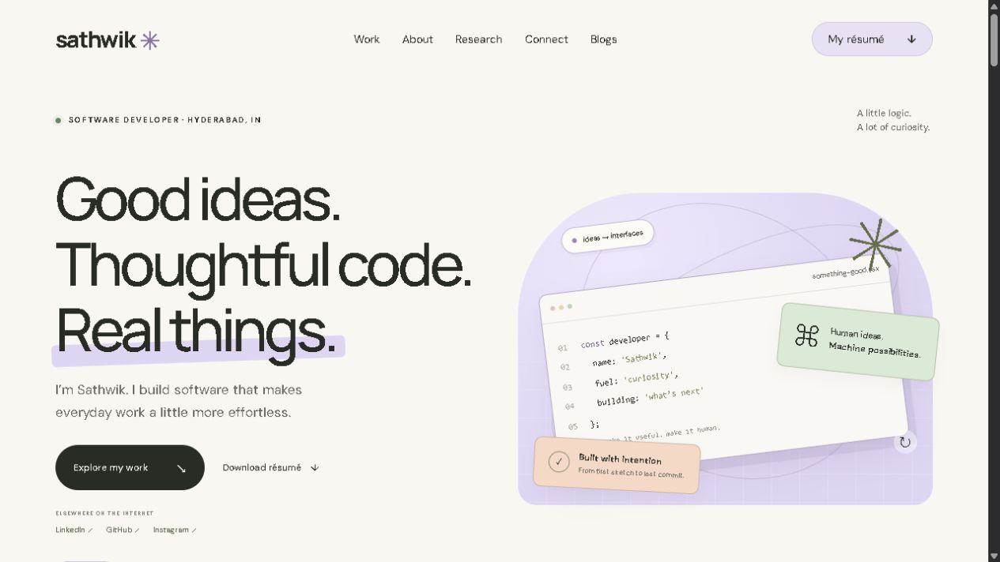

# Functional Portfolio

A responsive portfolio for **Sathwik Tadivaka**, with pastel project mockups, a private content studio, and a rich blog writing room. Firebase Hosting serves the website; Supabase provides authentication, content, and image storage.

**Website:** [portfolio.sathwiktadivaka.com](https://portfolio.sathwiktadivaka.com)  
**Admin:** [Open the content studio](https://portfolio.sathwiktadivaka.com/admin/)  
**Source:** [Sanju2911/functional-portfolio](https://github.com/Sanju2911/functional-portfolio)



## Features

- Responsive software portfolio with original CSS/SVG illustrations, project detail dialogs, research interests, experience, resume preview/download, and social links.
- Protected administrator sign-in with Supabase Auth and database row-level security.
- Project editing, ordering, drafts, publishing, archives, covers, and screenshot galleries.
- Five editable cover templates: **Smartwatch, Browser, Terminal, Travel browser, and Phone**. Adjust frame position, size, tilt, shadow, corners, screenshot zoom/crop/fit, cover text, and pastel colors with a live preview.
- One portrait with configurable frame, crop, zoom, grayscale, brightness, and saturation.
- A rich blog canvas with headings, text sizes, bold/italic/underline, colors, highlighting, lists, alignment, quotes, code, links, inline images, undo/redo, and reading preview.
- Immediate device draft backups, automatic private cloud saving, refresh recovery, and separate Drafts and Published views. Revisions stay private until explicitly published.
- Shared site typography and sanitized rich content; optional public blog visibility.

See the [complete feature guide](docs/FEATURES.md) for behavior, controls, and limits.

## Run locally

Use Node.js 20 or later. No build step or dependency installation is required.

```sh
npm start
```

Open [127.0.0.1:4173](http://127.0.0.1:4173/). Live content and sign-in require access to the configured Supabase backend.

## Checks

```sh
npm run check
npm run test:public
```

The checks cover JavaScript syntax, local asset references, private credential patterns, cover rendering safeguards, and anonymous database access. See the [release verification record](docs/VALIDATION.md) for the deployed smoke-test results. Browser rich-text checks and transaction-only SQL permission tests are included under [database/](database/).

## Deploy

The checked-in Firebase configuration targets the existing **portfolio-0129** Hosting site and publishes only **dist/**:

```sh
firebase login
npm run deploy
```

Follow the [deployment and maintenance guide](docs/DEPLOYMENT.md), including Supabase sign-in redirect configuration. Do not rerun database installation against an existing populated CMS.

## Repository map

| Path | Purpose |
| --- | --- |
| dist/index.html, style.css, enhancements.css | Portfolio structure and visual design |
| dist/app.js, design.js, cms-public.js | Portfolio interactions and live content |
| dist/project-covers.* | Shared project mockup renderer |
| dist/admin/ | Authenticated content studio and editors |
| dist/blogs/ | Public blog index and article reader |
| dist/resume/ | Four-page PDF preview, accessible text, and download |
| dist/blog-content.* | Shared safe rich-text format and typography |
| dist/cms-client.js | Public Supabase client configuration |
| dist/assets/ | Portfolio screenshots, icon, and downloadable resume |
| database/ | Schema, additive migrations, seed content, and checks |
| docs/ | Feature and deployment documentation |
| scripts/check.mjs | Dependency-free release checks |
| firebase.json, .firebaserc | Explicit Firebase Hosting target |

## Configuration and content

The Supabase URL and publishable key in the browser client are public identifiers. Security depends on the included Auth membership checks, RLS policies, and Storage rules. No administrator password, service-role key, Firebase token, or GitHub token belongs in this repository.

Projects, portrait settings, and blog content can be maintained in /admin/ without redeployment. Base portfolio copy, experience, research, social links, and the resume remain source-managed. Device-only draft backups are scoped to their browser and domain; wait for cloud draft sync before switching hosts.

Project screenshots originate from the owner's GitHub work. Demo/sample state and project limitations are described in the portfolio. Research is labeled as exploration rather than published findings. The downloadable PDF resume is intentionally part of the public site.

Built with HTML, CSS, JavaScript, Firebase Hosting, and Supabase. DM Sans and Manrope supply the site typography, with system fallbacks. Third-party library license information is in [THIRD_PARTY_NOTICES.md](THIRD_PARTY_NOTICES.md).
