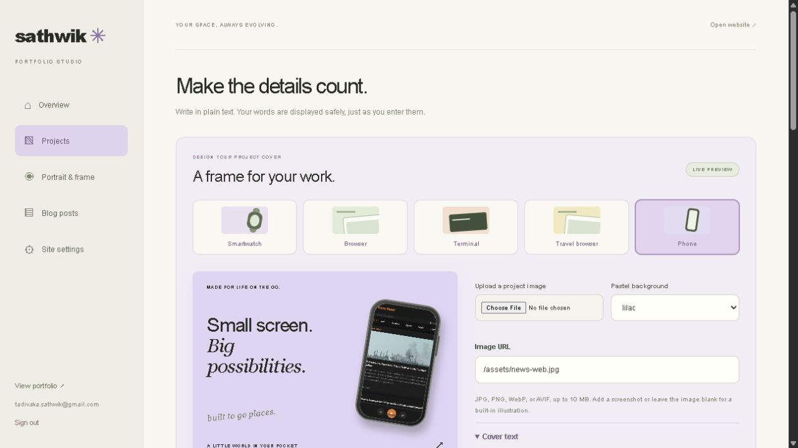
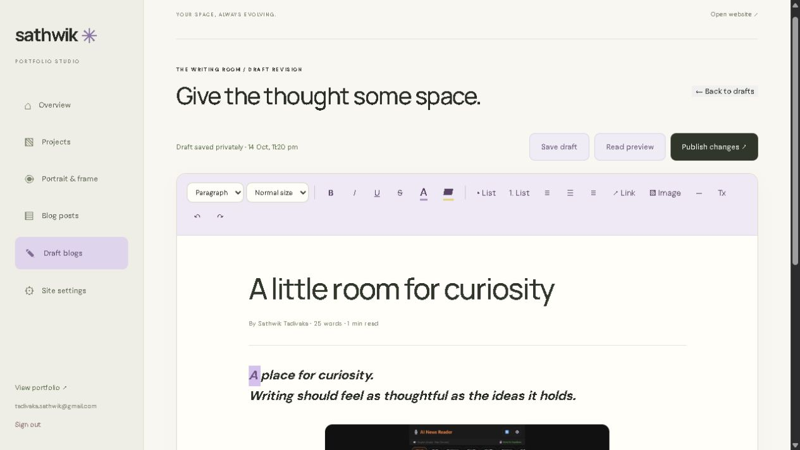

# Functional Portfolio — feature guide

This is Sathwik Tadivaka's software portfolio and a working example of a database-backed content management system.

## Visitor experience

| Area | What visitors can do |
| --- | --- |
| Portfolio | Browse a responsive pastel interface with illustrated software graphics, restrained animation, section navigation, and reduced-motion support. |
| Projects | See selected work, tags, mockups, project stories, screenshots, repository links, and demo links. Open project details with keyboard-accessible dialogs. |
| About | View one portrait, education, background, and professional experience. |
| Research | Read clearly labeled interests in AI intelligence, machine learning, and connected systems. These are explorations, not claimed publications. |
| Resume | Download the supplied Word resume. |
| Connect | Open LinkedIn, GitHub, Instagram, or an email link; copy the contact email. |
| Blog | Browse published posts and read formatted articles. Blog navigation and content visibility follow the administrator's setting. |

## Private administration

Open `/admin/` directly. The route is intentionally absent from public navigation. Sign in with an approved Supabase Auth account. A hidden URL alone is not the security boundary: database and Storage policies enforce administrator access.

### Projects

- Create and edit titles, descriptions, introductions, stories, implementation notes, status, tags, and links.
- Publish or retain a project as a private draft; set display order; archive and restore.
- Upload a cover image and up to 12 gallery images. Supported formats: JPG, PNG, WebP, AVIF; maximum source size 10 MB. Uploads are resized to a maximum 1920-pixel edge and converted to WebP.
- Choose **Smartwatch**, **Browser**, **Terminal**, **Travel browser**, or **Phone** covers.
- Edit cover headings, headline, footer, window label, terminal text, and pastel background.
- Adjust frame size, horizontal/vertical position, tilt, corner radius, and shadow.
- Adjust screenshot fit, zoom, and horizontal/vertical crop. Reset the frame without replacing the source image.
- Preview the same shared cover renderer used by the public portfolio before saving.

### Portrait

Upload one photo and select a circle, arch, rounded rectangle, or square frame. Adjust width, height where applicable, crop, zoom, grayscale, brightness, and saturation. The caption is “HELLO, I'M SATHWIK.”

### Blog writing room

The canvas replaces separate introduction and body fields. The beginning of the canvas becomes the list-card introduction automatically.

| Tool | Behavior |
| --- | --- |
| Typography | Paragraphs, three heading levels, text sizes, bold, italic, underline, strikethrough, quotes, and code blocks. |
| Color | Text color and background highlight controls. |
| Structure | Bullet/numbered lists, alignment, dividers, links, undo, redo, and clear formatting. |
| Images | Upload an inline image or insert an HTTPS image URL, supply an accessible description, and choose full, medium, or small width. A separate cover image is optional. |
| Reading | Read preview inside the studio; published articles use the same DM Sans body and Manrope heading fonts as the website. Pasted font families and unsafe markup are stripped. |
| Titles | Long titles wrap and resize within the writing paper. |

### Drafts and publishing

1. Start a post. Text and formatting are backed up immediately in account-scoped browser storage.
2. After a short pause (900 ms), the draft syncs to the private `portfolio_post_drafts` table. Read the save indicator to confirm cloud sync.
3. Refreshing restores the last open draft. Use **Draft blogs** in the sidebar or `/admin/#drafts` to resume other drafts.
4. Click **Publish post** when ready. For an existing published article, unfinished edits remain a private draft revision until **Publish changes**.
5. Use **Blog posts → Published** to read and edit existing posts. A published post can be moved back to drafts. Archived posts can be restored.

Cloud failures retain the device backup and show a retry message. Device-only backups belong to that browser and origin: they do not automatically move between the old preview domain, Firebase domains, and the custom domain. Use **Save draft** and wait for “Draft saved privately” before switching domains. If both cloud saving and local backup fail, the browser warns before leaving.

Optimistic timestamps detect concurrent cloud edits. If another tab changed a draft, reopen it before continuing. Image uploads must finish before leaving the editor or publishing.

### Site settings

Toggle the public blog. Disabling it hides public navigation and published article access while retaining all post and draft records. The database also blocks anonymous access to blog posts while disabled.

## Data and security

| Resource | Access |
| --- | --- |
| `portfolio_settings` | Public read; approved administrator update. |
| `portfolio_projects` | Public reads published, unarchived projects; approved administrators manage all projects. |
| `portfolio_posts` | Public reads published, unarchived posts only when blogs are enabled; approved administrators manage posts. |
| `portfolio_post_drafts` | Approved administrators only. No anonymous access or client deletion grant. |
| `portfolio_admins` | A signed-in user may check their own membership. Client code cannot grant membership. |
| `portfolio-media` | Public image delivery; approved administrator upload, update, and management. |

The Supabase URL and publishable key are intentionally public client identifiers. Row-level security protects the data. Passwords, service-role keys, Firebase credentials, and GitHub tokens do not belong in this repository.

## Technical shape

Buildless HTML, CSS, and browser JavaScript run on Firebase Hosting. Supabase supplies Auth, Postgres, and image Storage. The public site reads live CMS data, so ordinary content edits do not require redeployment. Base portfolio copy, the research section, social links, and the resume file are source-managed.

No visitor tracking or contact form backend is included. The rich editor uses browser editing commands, which should be retested when adopting another browser engine. Image presentation settings do not alter source images; the upload pipeline does resize/compress uploaded files for delivery.

## Interface previews

### Project cover templates

### Blog writing canvas

